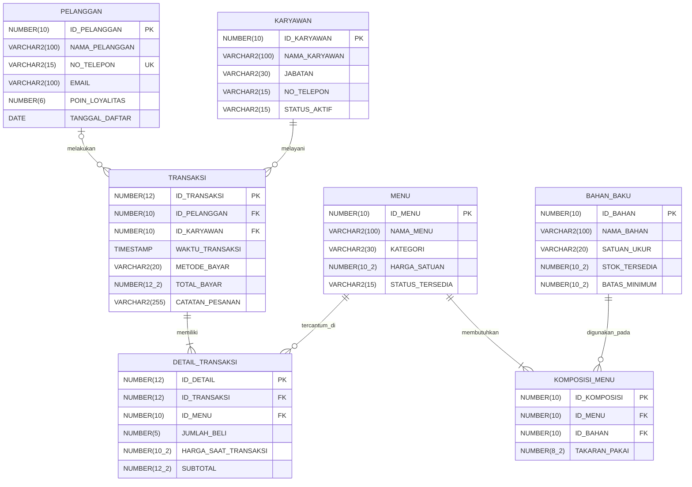

# Rancangan Database: Sistem Kasir & Inventaris Kedai Kopi ("Kedai Nusantara")
**Peran:** Orang 1 — Database Designer & Database Analyst  
**Target DBMS:** Oracle Database  

---

## 1. Analisis Kebutuhan Sistem & Aturan Bisnis

### 1.1 Deskripsi Singkat Sistem
Sistem Kasir & Inventaris Kedai Kopi ("Kedai Nusantara") digunakan untuk mencatat operasional harian kedai kopi, meliputi pengelolaan data pelanggan terdaftar, data karyawan kasir/barista, daftar menu minuman/makanan, transaksi penjualan beserta rincian item yang dibeli, serta manajemen stok bahan baku dan komposisi resep tiap menu.

### 1.2 Aturan Bisnis Utama
1. **Pelanggan & Transaksi:** Pelanggan dapat mendaftar sebagai member untuk mendapatkan poin/riwayat belanja, namun pembeli umum (*walk-in customer*) tetap dapat bertransaksi tanpa wajib mendaftar (`PELANGGAN` bersifat opsional pada `TRANSAKSI`).
2. **Karyawan & Transaksi:** Setiap transaksi penjualan wajib dilayani dan dicatat oleh tepat satu karyawan yang bertugas.
3. **Rincian Transaksi:** Satu transaksi harus memiliki minimal satu item menu yang dipesan, dan satu menu dapat muncul di banyak transaksi (`M:N` yang dipecah menggunakan entitas asosiatif `DETAIL_TRANSAKSI`). Harga satuan saat transaksi disimpan di `DETAIL_TRANSAKSI` agar riwayat transaksi tetap akurat meski harga menu di master berubah di kemudian hari.
4. **Menu & Bahan Baku (Resep):** Setiap menu terbuat dari satu atau beberapa bahan baku (misalnya biji kopi, susu cair, gula aren), dan satu bahan baku dapat digunakan oleh banyak menu (`M:N` yang dipecah menggunakan entitas asosiatif `KOMPOSISI_MENU`).

---

## 2. Identifikasi Entitas, Atribut, Kunci (PK/FK), & Tipe Data Oracle

Sistem ini terdiri dari **7 entitas** yang telah dinormalisasi hingga **3NF**:
1. `PELANGGAN`
2. `KARYAWAN`
3. `MENU`
4. `TRANSAKSI`
5. `DETAIL_TRANSAKSI`
6. `BAHAN_BAKU`
7. `KOMPOSISI_MENU`

### 2.1 Tabel `PELANGGAN`
Menyimpan data pelanggan yang terdaftar sebagai member kedai.

| Nama Atribut | Key | Tipe Data Oracle | Wajib / Opsional | Keterangan |
| :--- | :--- | :--- | :--- | :--- |
| `ID_PELANGGAN` | **PK** | `NUMBER(10)` | Wajib (`NOT NULL`) | Identitas unik pelanggan terdaftar |
| `NAMA_PELANGGAN` | - | `VARCHAR2(100)` | Wajib (`NOT NULL`) | Nama lengkap pelanggan |
| `NO_TELEPON` | - | `VARCHAR2(15)` | Wajib (`NOT NULL`, `UNIQUE`) | Nomor ponsel untuk identifikasi member |
| `EMAIL` | - | `VARCHAR2(100)` | Opsional (`NULL`) | Alamat email pelanggan |
| `POIN_LOYALITAS` | - | `NUMBER(6)` | Wajib (`NOT NULL`) | Akumulasi poin belanja (default 0) |
| `TANGGAL_DAFTAR` | - | `DATE` | Wajib (`NOT NULL`) | Tanggal registrasi member |

### 2.2 Tabel `KARYAWAN`
Menyimpan data staf kedai kopi yang mengoperasikan kasir atau membuat pesanan.

| Nama Atribut | Key | Tipe Data Oracle | Wajib / Opsional | Keterangan |
| :--- | :--- | :--- | :--- | :--- |
| `ID_KARYAWAN` | **PK** | `NUMBER(10)` | Wajib (`NOT NULL`) | Identitas unik karyawan |
| `NAMA_KARYAWAN` | - | `VARCHAR2(100)` | Wajib (`NOT NULL`) | Nama lengkap karyawan |
| `JABATAN` | - | `VARCHAR2(30)` | Wajib (`NOT NULL`) | Posisi kerja (Kasir, Barista, Manajer) |
| `NO_TELEPON` | - | `VARCHAR2(15)` | Wajib (`NOT NULL`) | Nomor kontak aktif karyawan |
| `STATUS_AKTIF` | - | `VARCHAR2(15)` | Wajib (`NOT NULL`) | Status kerja (`AKTIF` / `NONAKTIF`) |

### 2.3 Tabel `MENU`
Menyimpan daftar produk minuman dan makanan yang dijual di kedai.

| Nama Atribut | Key | Tipe Data Oracle | Wajib / Opsional | Keterangan |
| :--- | :--- | :--- | :--- | :--- |
| `ID_MENU` | **PK** | `NUMBER(10)` | Wajib (`NOT NULL`) | Identitas unik item menu |
| `NAMA_MENU` | - | `VARCHAR2(100)` | Wajib (`NOT NULL`) | Nama menu (mis. Kopi Susu Gula Aren) |
| `KATEGORI` | - | `VARCHAR2(30)` | Wajib (`NOT NULL`) | Kategori (`KOPI`, `NON-KOPI`, `MAKANAN`) |
| `HARGA_SATUAN` | - | `NUMBER(10,2)` | Wajib (`NOT NULL`) | Harga jual per porsi/gelas |
| `STATUS_TERSEDIA` | - | `VARCHAR2(15)` | Wajib (`NOT NULL`) | Ketersediaan (`TERSEDIA` / `HABIS`) |

### 2.4 Tabel `TRANSAKSI`
Menyimpan header catatan transaksi penjualan.

| Nama Atribut | Key | Tipe Data Oracle | Wajib / Opsional | Keterangan |
| :--- | :--- | :--- | :--- | :--- |
| `ID_TRANSAKSI` | **PK** | `NUMBER(12)` | Wajib (`NOT NULL`) | Nomor unik transaksi penjualan |
| `ID_PELANGGAN` | **FK** | `NUMBER(10)` | Opsional (`NULL`) | Referensi ke `PELANGGAN(ID_PELANGGAN)`; bernilai NULL jika pembeli non-member |
| `ID_KARYAWAN` | **FK** | `NUMBER(10)` | Wajib (`NOT NULL`) | Referensi ke `KARYAWAN(ID_KARYAWAN)` yang melayani |
| `WAKTU_TRANSAKSI` | - | `TIMESTAMP` | Wajib (`NOT NULL`) | Tanggal dan jam transaksi terjadi |
| `METODE_BAYAR` | - | `VARCHAR2(20)` | Wajib (`NOT NULL`) | Metode pembayaran (`TUNAI`, `QRIS`, `DEBIT`) |
| `TOTAL_BAYAR` | - | `NUMBER(12,2)` | Wajib (`NOT NULL`) | Total nominal pembayaran transaksi |
| `CATATAN_PESANAN` | - | `VARCHAR2(255)` | Opsional (`NULL`) | Catatan tambahan pesanan (mis. *less sugar*) |

### 2.5 Tabel `DETAIL_TRANSAKSI`
Entitas asosiatif yang memecah relasi Many-to-Many (`M:N`) antara `TRANSAKSI` dan `MENU`.

| Nama Atribut | Key | Tipe Data Oracle | Wajib / Opsional | Keterangan |
| :--- | :--- | :--- | :--- | :--- |
| `ID_DETAIL` | **PK** | `NUMBER(12)` | Wajib (`NOT NULL`) | Identitas unik baris item transaksi |
| `ID_TRANSAKSI` | **FK** | `NUMBER(12)` | Wajib (`NOT NULL`) | Referensi ke `TRANSAKSI(ID_TRANSAKSI)` |
| `ID_MENU` | **FK** | `NUMBER(10)` | Wajib (`NOT NULL`) | Referensi ke `MENU(ID_MENU)` |
| `JUMLAH_BELI` | - | `NUMBER(5)` | Wajib (`NOT NULL`) | Kuantitas porsi/gelas yang dipesan |
| `HARGA_SAAT_TRANSAKSI` | - | `NUMBER(10,2)` | Wajib (`NOT NULL`) | Harga menu saat transaksi berlangsung |
| `SUBTOTAL` | - | `NUMBER(12,2)` | Wajib (`NOT NULL`) | Hasil perkalian `JUMLAH_BELI * HARGA_SAAT_TRANSAKSI` |

### 2.6 Tabel `BAHAN_BAKU`
Menyimpan data stok bahan mentah untuk pembuatan menu.

| Nama Atribut | Key | Tipe Data Oracle | Wajib / Opsional | Keterangan |
| :--- | :--- | :--- | :--- | :--- |
| `ID_BAHAN` | **PK** | `NUMBER(10)` | Wajib (`NOT NULL`) | Identitas unik bahan baku |
| `NAMA_BAHAN` | - | `VARCHAR2(100)` | Wajib (`NOT NULL`) | Nama bahan (mis. Biji Arabika, Susu UHT) |
| `SATUAN_UKUR` | - | `VARCHAR2(20)` | Wajib (`NOT NULL`) | Satuan stok (`GRAM`, `ML`, `PCS`) |
| `STOK_TERSEDIA` | - | `NUMBER(10,2)` | Wajib (`NOT NULL`) | Jumlah stok fisik yang tersedia saat ini |
| `BATAS_MINIMUM` | - | `NUMBER(10,2)` | Wajib (`NOT NULL`) | Ambang batas peringatan stok menipis |

### 2.7 Tabel `KOMPOSISI_MENU`
Entitas asosiatif yang memecah relasi Many-to-Many (`M:N`) antara `MENU` dan `BAHAN_BAKU` (takaran resep).

| Nama Atribut | Key | Tipe Data Oracle | Wajib / Opsional | Keterangan |
| :--- | :--- | :--- | :--- | :--- |
| `ID_KOMPOSISI` | **PK** | `NUMBER(10)` | Wajib (`NOT NULL`) | Identitas unik baris resep |
| `ID_MENU` | **FK** | `NUMBER(10)` | Wajib (`NOT NULL`) | Referensi ke `MENU(ID_MENU)` |
| `ID_BAHAN` | **FK** | `NUMBER(10)` | Wajib (`NOT NULL`) | Referensi ke `BAHAN_BAKU(ID_BAHAN)` |
| `TAKARAN_PAKAI` | - | `NUMBER(8,2)` | Wajib (`NOT NULL`) | Jumlah bahan yang dipakai per 1 porsi menu |

---

## 3. Relasi Antar Entitas & Kardinalitas

| Entitas Induk (Parent) | Entitas Anak (Child) | Kardinalitas | Notasi Crow's Foot | Alasan & Penjelasan Relasi |
| :--- | :--- | :---: | :---: | :--- |
| `PELANGGAN` | `TRANSAKSI` | **1 : 0..N** | `\|o--o{` | Satu pelanggan member dapat melakukan nol atau banyak transaksi. Satu transaksi boleh tidak terhubung ke pelanggan terdaftar (pembeli umum/non-member) atau terhubung ke tepat satu pelanggan. |
| `KARYAWAN` | `TRANSAKSI` | **1 : 0..N** | `\|\|--o{` | Satu karyawan dapat melayani nol (karyawan baru) atau banyak transaksi. Setiap transaksi wajib dicatat oleh tepat satu karyawan. |
| `TRANSAKSI` | `DETAIL_TRANSAKSI` | **1 : 1..N** | `\|\|--\|{` | Satu transaksi wajib memuat minimal satu hingga banyak rincian item pesanan. Setiap baris detail milik tepat satu transaksi. |
| `MENU` | `DETAIL_TRANSAKSI` | **1 : 0..N** | `\|\|--o{` | Satu item menu dapat dipesan pada nol (menu baru) atau banyak rincian transaksi. Setiap baris detail merujuk pada tepat satu menu. |
| `MENU` | `KOMPOSISI_MENU` | **1 : 1..N** | `\|\|--\|{` | Satu menu tersusun dari minimal satu hingga banyak bahan baku. Setiap baris komposisi merujuk pada tepat satu menu. |
| `BAHAN_BAKU` | `KOMPOSISI_MENU` | **1 : 0..N** | `\|\|--o{` | Satu bahan baku dapat dipakai pada nol atau banyak resep menu. Setiap baris komposisi merujuk pada tepat satu bahan baku. |

---

## 4. Pemeriksaan Normalisasi Database (1NF — 3NF)

### 4.1 First Normal Form (1NF) — Bebas Repeating Groups & Atomik
* **Pemeriksaan:** Seluruh atribut pada ke-7 tabel menyimpan nilai tunggal (*atomic*). Daftar menu yang dibeli dalam satu struk transaksi tidak disimpan dalam satu kolom berulang (mis. `menu_1, menu_2` atau dipisahkan koma), melainkan dipisahkan ke dalam baris-baris tersendiri pada tabel `DETAIL_TRANSAKSI`. Begitu pula daftar bahan per menu dipisahkan ke tabel `KOMPOSISI_MENU`.
* **Status:** **Memenuhi 1NF.**

### 4.2 Second Normal Form (2NF) — Bebas Partial Dependency
* **Pemeriksaan:** Seluruh tabel menggunakan *Single-Attribute Primary Key* (`ID_PELANGGAN`, `ID_KARYAWAN`, `ID_MENU`, `ID_TRANSAKSI`, `ID_DETAIL`, `ID_BAHAN`, `ID_KOMPOSISI`), sehingga tidak mungkin terjadi ketergantungan parsial (*partial dependency*) terhadap sebagian kunci primer. Atribut seperti `JUMLAH_BELI` dan `SUBTOTAL` bergantung penuh pada `ID_DETAIL`, bukan hanya pada `ID_TRANSAKSI` atau `ID_MENU`.
* **Status:** **Memenuhi 2NF.**

### 4.3 Third Normal Form (3NF) — Bebas Transitive Dependency
* **Pemeriksaan:** Tidak ada atribut non-kunci yang bergantung pada atribut non-kunci lainnya:
  * Pada `TRANSAKSI`, informasi profil pelanggan (`NAMA_PELANGGAN`, `NO_TELEPON`) tidak disimpan ulang di tabel transaksi melainkan cukup merujuk `ID_PELANGGAN`.
  * Pada `DETAIL_TRANSAKSI`, nama menu dan kategori tidak disimpan ulang karena sudah berada di `MENU` dan hanya bergantung pada `ID_MENU`. (Kolom `HARGA_SAAT_TRANSAKSI` disimpan sebagai *historical snapshot* harga transaksi, bukan ketergantungan transitif terhadap harga master saat ini).
  * Pada `KOMPOSISI_MENU`, satuan ukur dan stok fisik bahan tetap berada di `BAHAN_BAKU` sehingga tidak menimbulkan anomali pembaruan (*update anomaly*) saat stok berubah.
* **Status:** **Memenuhi 3NF.**

---

## 5. Entity Relationship Diagram (ERD — Notasi Crow's Foot)

Kode diagram Mermaid berikut merepresentasikan struktur ERD lengkap yang dapat langsung dirender menjadi file gambar **`erd.png`**:

---

## 6. Validasi Kelengkapan Tugas (Orang 1 — Database Designer)
- [x] Seluruh kebutuhan data & aturan bisnis sudah terwakili oleh entitas dan atribut.
- [x] Tipe data disesuaikan dengan standar **Oracle Database** (`NUMBER`, `VARCHAR2`, `DATE`, `TIMESTAMP`).
- [x] Relasi Many-to-Many (`TRANSAKSI`–`MENU` dan `MENU`–`BAHAN_BAKU`) telah dipecah menggunakan entitas asosiatif.
- [x] Kardinalitas Crow's Foot dan status wajib (`NOT NULL`) / opsional (`NULL`) sudah terdefinisi jelas.
- [x] Struktur tabel telah tervalidasi memenuhi normalisasi **1NF, 2NF, dan 3NF**.
- [x] Tidak menyertakan kode SQL implementasi (menjaga batasan tugas antaranggota kelompok).